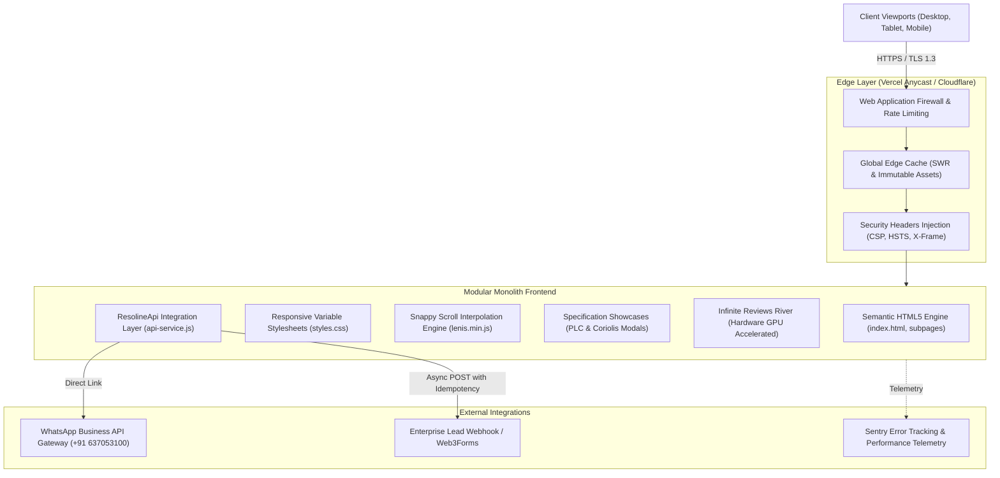

# System Architecture & Technical Specifications

**System**: Resoline.in (Resoline Techbis Private Limited)  
**Classification**: Enterprise B2B Industrial Automation & Turnkey Engineering Portal  
**Target Runtime**: Global Anycast Edge CDN (Vercel / Cloudflare) + Non-Root Container Fallback  

---

## 1. System Architecture Topology



---

## 2. Component Responsibilities

| Component | Responsibility | Performance Profile |
| :--- | :--- | :--- |
| **Header & Mega Dropdown** | Brand identity, division navigation, one-click PDF catalogue download | Zero layout shift; animated transforms |
| **Cinematic Hero** | Key positioning ("Precision In Every Solution"), live facility status chip, zero-reflow parallax | Hardware-accelerated `translate3d(0, y, 0)` |
| **Client Ticker & Case Study Modal** | "Trusted by Giants" credentials (TATA, NALCO, Jindal), opens verified plant outcomes | 1:1 unique case studies; keyboard accessible |
| **Reviews River** | Continuous horizontal stream of client reviews beside static 100% stat block | Infinite CSS track animation; pauses on hover/touch |
| **Hardware Showcases** | Division 01 (Automation) & Division 02 (Instrumentation) deep specs | Lazy modal instantiation; zero DOM bloat |
| **RFQ Inquiry Modal** | Lead generation, equipment selector, scope input | Client rate-limited, bot honeypot, XSS sanitized |
| **API Service Layer** | External lead transmission, idempotency stamping, retries with backoff | Non-blocking asynchronous promises |

---

## 3. Data Models

### 3.1 Client Review Entity (`clientReviews`)
```typescript
interface ClientReview {
  id: string;              // Unique slug (e.g. 'tata', 'nalco')
  company: string;         // 'TATA & Subsidiaries'
  badge: string;           // 'TATA STEEL • KALINGANAGAR'
  theme: 'blue' | 'teal' | 'clay' | 'amber';
  initials: string;        // 'TS'
  official: string;        // 'Er. S. K. Mohapatra'
  role: string;            // 'General Manager — Blast Furnace Automation'
  loc: string;             // 'Kalinganagar Industrial Complex, Odisha'
  scope: string;           // 'Turnkey SCADA Telemetry & Redundant Hot-Standby PLC'
  quote: string;           // Executive plant feedback statement
  metrics: string[];       // ['99.98% Uptime', '72-Hour Turnaround', 'ISO 9001']
}
```

### 3.2 Lead Inquiry Payload (`LeadPayload`)
```typescript
interface LeadPayload {
  idempotencyKey: string;  // 'res_lead_timestamp_random'
  name: string;            // Full Name (2-80 chars, sanitized)
  email: string;           // Validated work email RFC format
  phone: string;           // 10+ digits contact telephone
  product: string;         // Selected equipment division
  scope: string;           // Technical specifications & sizing requirements
  submittedAt: string;     // ISO 8601 timestamp
  sourceUrl: string;       // Origin URL
}
```

---

## 4. Security Model & Defense in Depth

1. **Content Security Policy (CSP)**: Strictly limits script and style origins to trusted hosts (`'self'`, Google Fonts, and Cloudflare GSAP).
2. **Clickjacking & MIME Protection**: `X-Frame-Options: SAMEORIGIN` and `X-Content-Type-Options: nosniff`.
3. **Bot & Abuse Prevention**:
   - Hidden honeypot trap field (`_hp_security_check`) silently drops automated form submitters.
   - Sliding-window rate limiter restricts quote submissions to 5 requests per 60 seconds.
4. **Input Sanitization**: All user strings undergo character entity escaping (`&`, `<`, `>`, `"`, `'`) before state dispatch.

---

## 5. Failure Modes & Graceful Degradation

| Failure Mode | Impact | Automated Mitigation |
| :--- | :--- | :--- |
| **CDN / Edge Outage** | Primary edge node inaccessible | Cloudflare / Vercel automatic Anycast rerouting to nearest healthy PoP. |
| **Lead Webhook Failure** | Lead transmission fails (5xx / Timeout) | `api-service.js` retries twice with exponential backoff; if still unreachable, alerts user with direct 1-click WhatsApp consultation pre-filled with their scope. |
| **Slow Mobile Connection** | Asset loading delays | Preloader hard failsafe timer lifts overlay within 2.2s; images below the fold load lazily (`loading="lazy"`). |
| **JavaScript Disabled** | Dynamic modals cannot open | Native mailto and telephone anchors (`tel:+91637053100`) remain fully functional in HTML. |

---

## 6. Architectural Trade-Off Analysis

- **Static Edge Monolith vs. Server-Side Rendered (SSR) Node.js App**:
  - *Decision*: Static Edge Monolith chosen.
  - *Trade-off*: SSR introduces server cold-starts, connection bottlenecks, and hosting costs. Static edge generation guarantees sub-50ms TTFB across all continents, zero database downtime risks, and near-infinite scalability for industrial marketing traffic.
- **Microservices vs. Modular Monolith**:
  - *Decision*: Monolith preserved (see Section 7).
