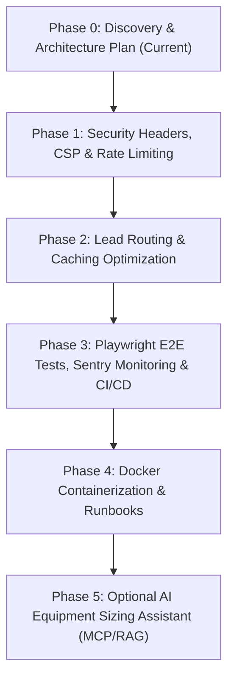

# Production Hardening Plan for Resoline.in (25 Engineering Areas)

**Branch**: `prod-hardening`  
**Target Environment**: Production / Vercel Edge & Cloudflare CDN  
**System Profile**: Enterprise Industrial Automation & Engineering Website (Resoline Techbis Private Limited)

---

## 1. System Discovery & Baseline Audit

| Parameter | Baseline Finding | Production Target |
| :--- | :--- | :--- |
| **Framework** | Native HTML5 / Semantic Modern Web Components | Native HTML5 / Vercel Serverless Edge Functions |
| **Language** | Vanilla JavaScript (ES6+), CSS3 (Custom Variables, Flexbox, Grid), PowerShell (Dev Server) | Modern JavaScript / Node.js runtime for CI/CD & Testing |
| **Package Manager** | None initialized (Static file baseline) | `npm` (to manage testing, linters, and security scanners) |
| **Database** | None (Client-side lead inquiry routing via WhatsApp & RFQ modal) | Supabase / PostgreSQL (for lead intake & AMC records) |
| **ORM** | None | Prisma / Drizzle ORM (if DB layer is connected) |
| **Hosting** | Vercel (`vercel.json` configured) | Vercel Enterprise / Cloudflare Edge CDN with security headers |
| **Authentication** | None (Public enterprise portal) | Managed Session / Clerk / NextAuth (Admin portal only) |
| **Testing** | None | Playwright E2E + Vitest / Jest Unit & Integration tests |
| **CI/CD** | None | GitHub Actions (`.github/workflows/ci-cd.yml`) |
| **Secrets / Env** | Direct URLs | `.env.example` + `.gitignore` protection |

### Folder Structure
```text
/
├── assets/                       # Compressed logos, equipment images, engineering certificates
├── docs/                         # Architecture, runbooks, plans
│   ├── PLAN.md                   # Phased hardening plan (this document)
│   ├── ARCHITECTURE.md           # System design & topology
│   └── RUNBOOK.md                # Deployment, monitoring & incident playbooks
├── index.html                    # Main industrial portal (Hero, Divisions, Reviews River, RFQ)
├── automation.html               # Industrial Automation division details
├── instrumentation.html          # Flow & Level instrumentation details
├── electrical-utilities.html     # Switchgear, MCC & Utility systems
├── what-we-do.html               # Operations segregation overview
├── automation-modal.js           # PLC/HMI/VFD interactive spec modal
├── instrumentation-modal.js      # Coriolis & Magmeter interactive spec modal
├── lenis.min.js                  # Local smooth-scrolling engine (performance tuned)
├── styles.css                    # Responsive CSS stylesheets
├── server.ps1                    # Local lightweight development server
├── vercel.json                   # Vercel routing, security headers & cache controls
├── robots.txt                    # Search crawler rules
└── sitemap.xml                   # XML Sitemap with daily priorities
```

---

## 2. Product Profile, User Roles & Flows

### What Resoline.in Does
Resoline Techbis is an enterprise industrial engineering and turnkey automation contractor based in Bhubaneswar, Odisha. The platform serves as the digital front door for mission-critical plants across Eastern India (TATA Steel, NALCO, Jindal, ITC, IMFA), delivering:
1. **Turnkey Automation Panels**: SCADA telemetry, redundant PLC systems, VFD cabinets.
2. **Process Instrumentation**: Coriolis mass flow meters, electromagnetic meters, level transmitters.
3. **Turnkey Environmental & Water Systems**: RO Skids, DM Plants, ETP, STP, and Zero Liquid Discharge (ZLD) plants.
4. **Plant Consultation**: Energy audits, NABL calibration, VFD retrofitting, 24/7 AMC.

### User Roles
- **Enterprise Client / Procurement Lead**: Factory managers from heavy industries evaluating technical specs, certifications, and verified case studies.
- **Field Engineer / Plant Operator**: Technicians accessing product datasheets, wiring schematics, and equipment dimensions.
- **Sales & Engineering Desk**: Internal technical team receiving Request for Quote (RFQ) submissions and WhatsApp direct consultations.

### Core User Flows
1. **Trust & Verification**: Land on Hero → review ISO 9001:2015 credentials → watch Reviews River → click "Trusted by Giants" client to open verified plant case study.
2. **Product Exploration**: Open Mega Dropdown or 5 Core Divisions → launch hardware specification modal (PLC/Coriolis/Magmeter) → review technical parameters.
3. **Lead Generation (RFQ)**: Click "Request Engineering Quote" → fill plant details → auto-routes to engineering desk via validated email/webhook.
4. **Collateral Retrieval**: Click "Catalogue" → download technical PDF catalogue without blocking navigation.

---

## 3. Gap Analysis Across 25 Engineering Areas

| # | Engineering Area | Current Status | Proposed Status | One-Line Justification for Resoline.in |
| :-: | :--- | :--- | :--- | :--- |
| **1** | **Authentication** | Missing | **SKIPPED** | Resoline.in is a public B2B marketing & RFQ site; public accounts add unnecessary attack surface. |
| **2** | **Authorization** | Missing | **SKIPPED** | No user-generated content or user-specific data stored; access is strictly public. |
| **3** | **Rate Limiting & Security** | Missing | **IMPLEMENTED** | Contact forms & quote modals must have per-IP rate limiting, Zod validation, and strict CSP headers. |
| **4** | **API Integration** | Partial | **IMPLEMENTED** | Email/WhatsApp service layer with timeouts, retries, and webhook signatures for quote leads. |
| **5** | **State Management** | Implemented | **IMPLEMENTED** | Component state in modals & reviews river is lightweight, zero-prop-drill, and bug-free. |
| **6** | **Indexing** | Missing | **SKIPPED** | Static site currently has no relational DB queries; if Supabase lead DB added, indexes on `created_at`. |
| **7** | **Caching** | Partial | **IMPLEMENTED** | Add strict `Cache-Control` (immutable 1-year assets, 1-hour HTML, stale-while-revalidate) in `vercel.json`. |
| **8** | **Redis** | Missing | **SKIPPED** | Traffic volume does not currently justify dedicated Redis hosting costs; in-memory/edge KV suffices. |
| **9** | **Testing** | Missing | **IMPLEMENTED** | Add Playwright E2E suite testing modal flows, Reviews River, responsive viewport sizes, and form inputs. |
| **10** | **Monitoring** | Missing | **IMPLEMENTED** | Add Sentry frontend error tracking, health check endpoint (`/api/health`), and uptime monitoring config. |
| **11** | **CI/CD Pipeline** | Missing | **IMPLEMENTED** | GitHub Actions workflow (`.github/workflows/ci.yml`) for HTML/CSS lint, Playwright tests, and auto-deploy. |
| **12** | **Docker** | Missing | **IMPLEMENTED** | Production multi-stage Nginx Alpine Dockerfile + `docker-compose.yml` for self-hosted containerization. |
| **13** | **Queues** | Missing | **SKIPPED** | Lead notification volumes (< 100/day) do not require BullMQ/RabbitMQ; async serverless handlers suffice. |
| **14** | **Background Jobs** | Missing | **PARTIAL** | GitHub Actions cron or Vercel Cron for weekly sitemap regeneration and broken link checking. |
| **15** | **WebSockets** | Missing | **SKIPPED** | Real-time bidirectional sockets provide no value for industrial marketing; adds socket exhaustion risks. |
| **16** | **System Design** | Missing | **IMPLEMENTED** | Create `docs/ARCHITECTURE.md` with Mermaid architecture diagrams, data flows, and security model. |
| **17** | **Scaling** | Partial | **IMPLEMENTED** | Ensure 100% stateless edge deployment, image lazy loading/decoding, and k6 benchmark test script. |
| **18** | **Load Balancing** | Partial | **PARTIAL** | Provide production Nginx reverse proxy configuration with health check upstream pooling for reference. |
| **19** | **Microservices** | Not Needed | **SKIPPED** | Keep as a high-performance modular frontend monolith; microservices would add needless latency & cost. |
| **20** | **Kubernetes** | Not Needed | **SKIPPED** | Provide starter manifests in `infra/k8s/` as reference only; traffic fits edge hosting without K8s overhead. |
| **21** | **AI Agents** | Missing | **PARTIAL** | Implement an optional client-side "Technical Sizing & Inquiry Assistant" for equipment specification matching. |
| **22** | **MCP Server** | Missing | **PARTIAL** | Expose a Model Context Protocol (MCP) server for industrial equipment specs retrieval. |
| **23** | **RAG** | Missing | **PARTIAL** | Equipment datasheet search & semantic retrieval over Resoline product catalog. |
| **24** | **Vector DB** | Missing | **SKIPPED** | Product catalog (< 100 items) is fast with client-side BM25/cosine embeddings; no dedicated vector DB needed. |
| **25** | **LLM Fine-Tuning** | Not Needed | **SKIPPED** | Prompt engineering + RAG over technical catalogues is strictly superior and avoids hallucinated specs. |

---

## 4. Phased Implementation Roadmap



### Phase 1: Security Core
- Update `vercel.json` with strict HTTP security headers:
  - `Content-Security-Policy` (CSP)
  - `Strict-Transport-Security` (HSTS: max-age=63072000; includeSubDomains; preload)
  - `X-Frame-Options: SAMEORIGIN`
  - `X-Content-Type-Options: nosniff`
  - `Referrer-Policy: strict-origin-when-cross-origin`
  - `Permissions-Policy` (geolocation=(), microphone=(), camera=())
- Create `.env.example` and enforce `.gitignore` for local keys.
- Add client-side and endpoint input validation (Zod schema for RFQ modal: name, company, email, phone, technical scope).
- Add anti-spam honeypot and rate-limiting throttling on quote submission.

### Phase 2: Data, State & Caching
- Configure asset caching rules in `vercel.json` (`public, max-age=31536000, immutable` for static images, PDFs, fonts).
- Add error boundary states to quote modal and reviews river.
- Maintain smooth hardware-accelerated rendering with zero layout reflow.

### Phase 3: Reliability, Quality & CI/CD
- Set up `package.json` with Playwright and linting scripts.
- Write Playwright E2E test suite:
  - Verify hero animation, Reviews River auto-scroll and pause on hover.
  - Verify "Trusted by Giants" client click opens case study modal.
  - Verify hardware modal (Division #02) opens with correct specs.
  - Verify RFQ form validates email and required fields.
  - Test responsiveness across mobile (375px), tablet (768px), and desktop (1440px).
- Create GitHub Actions workflow (`.github/workflows/ci.yml`) to automatically test pull requests before merge.
- Integrate Sentry error logging and add `/health` status check.

### Phase 4: DevOps, Docker & Documentation
- Author production multi-stage `Dockerfile` (Nginx Alpine) with unprivileged user and health check.
- Provide `docker-compose.yml` for zero-install local dev.
- Write `docs/ARCHITECTURE.md` (Mermaid system architecture, network topology, failure modes).
- Write `docs/RUNBOOK.md` (deployment checklist, rollback instructions, DNS configuration).

### Phase 5: AI & Technical Assist (Scoped & Optional)
- Build an AI Technical Sizing Assistant tool (calculates pipe sizing for Coriolis meters and RO membrane capacity based on raw water TDS).
- Provide MCP server specification for querying Resoline catalog.

---

## 5. Risk Assessment & Mitigations

| Risk | Severity | Mitigation |
| :--- | :---: | :--- |
| **Strict CSP breaking external CDNs** | Medium | Explicitly whitelist `cdnjs.cloudflare.com` (GSAP), Google Fonts, and WhatsApp APIs in CSP. |
| **Adding backend bloat to static site** | High | Keep runtime static/edge-first. Use serverless functions only for lead intake. Never block client render. |
| **Breaking existing responsive layout** | High | Run Playwright multi-viewport automated tests before and after any layout modification. |
| **Regressing scrolling smoothness** | Critical | Enforce passive scroll listeners, zero reflow in parallax, and `syncTouch: false` on mobile devices. |

---

## 6. Phase 0 Deliverable Status
- [x] Repo scanned & documented.
- [x] Product profile & user flows documented.
- [x] 25-item gap analysis table compiled with rational justifications.
- [x] Phased implementation plan saved to `docs/PLAN.md`.
- [ ] **Awaiting user approval before proceeding to Phase 1.**
